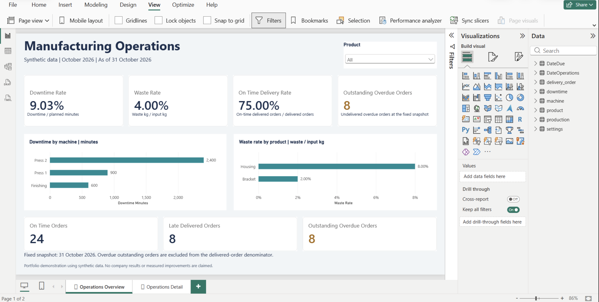
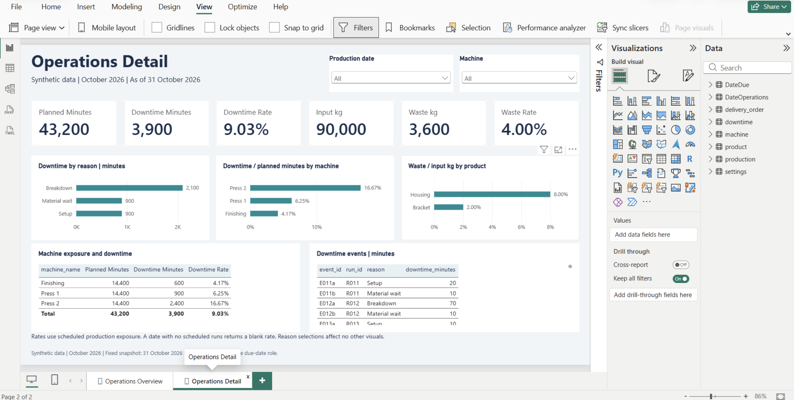

# Manufacturing Operations Analyst Portfolio

**Abdoulie J Bah · Venice, Italy · Employment portfolio**

**Synthetic demonstration. No company or client data. As of 2026-10-31 (end of day).**

A two-page Power BI report with reproducible SQL preparation, data-quality checks, and documented native DAX validation. **Synthetic data only; no real company performance or measured improvement is claimed.**

**Package status:** the completed [Power BI report](powerbi/Manufacturing_Operations.pbix), supporting files and screenshots are included. The supplied PBIX matches the SHA-256 in the Desktop verification record exactly; both report pages and archive integrity were checked on receipt.

## Report preview

### Operations Overview


### Operations Detail


Screenshots are actual Power BI Desktop captures, including the editing interface. The report is a local portfolio demonstration, not a published interactive web report.

## Business question

Which machines, products and delivery issues should an operations manager investigate first?

## Run locally

Requires Python 3 with its standard library only; no paid tools, packages or network required.

```sh
cd manufacturing-operations-github
python3 scripts/build.py
```

This deterministically regenerates the synthetic raw CSVs, rebuilds `results/manufacturing.sqlite`, runs SQL cleaning and checks, exports import-ready CSVs and writes `results/verification.json`. It overwrites generated data/results inside this package. Keep a copy before experimenting. Run from any directory using the script's absolute path if preferred. The SQL is SQLite dialect; the runner loads CSVs into `raw_*` tables, then executes the numbered SQL files in order. To explore, open the database with a SQLite client and run the SELECT statements from `sql/03_metrics.sql` without its CREATE/DROP statements.

## Delivered evidence

| Metric | SQL result | Definition |
|---|---:|---|
| Planned production | 43,200 min | Sum across 90 accepted runs |
| Downtime | 3,900 min | Sum of 180 non-overlapping events |
| Downtime rate | 9.0278% | Downtime / planned production minutes |
| Material input | 90,000 kg | Sum across accepted runs |
| Waste | 3,600 kg | Same mass unit as input |
| Waste rate | 4.0000% | Waste kg / input kg |
| Delivered orders | 32 | Full delivery by as-of date |
| On-time delivered orders | 24 | Delivery date <= original due date |
| On-time delivery rate | 75.0000% | 24 / 32; outstanding orders excluded |
| Outstanding overdue | 8 | Undelivered with due date strictly before as-of |

The denominator is planned scheduled run time, including the recorded downtime. This is a downtime rate, not a full OEE calculation. Rates use ratios of sums, never averages of row percentages.

## Three findings and proposed actions

1. **Press 2 accounts for 2,400 of 3,900 downtime minutes (61.54%).** Its downtime rate is 16.67%, versus 6.25% for Press 1 and 4.17% for Finishing. Of Press 2's downtime, 2,100 minutes are coded Breakdown. Investigate maintenance records and failure causes first; the data does not prove maintenance would reduce downtime. Evidence: `results/machine_metrics.csv`, `results/reason_metrics.csv`, and event rows filtered to M2.
2. **Housing has an 8% waste rate versus Bracket's 2%.** Housing contributes 2,400 kg, or 66.67% of total waste, using one-third of input. Review process settings and material handling. Housing is only produced on Press 2 in this fixture, so product and machine effects cannot be separated. Evidence: `results/product_metrics.csv`.
3. **Eight of 32 delivered orders are late; eight additional orders are overdue and undelivered.** The delivered-order rate is 75%; counting backlog in that denominator would change the question. Review the eight late and eight outstanding order IDs before prioritizing follow-up. This does not establish that machine downtime caused delivery delays: orders have no production allocation link. Evidence: `data/clean/delivery_order.csv`.

## Data quality and reproducibility

Raw counts: 94 production rows (90 valid + one exact replay + three invalid); 182 downtime rows (180 valid + two invalid); 40 orders; 33 deliveries (32 valid + one invalid). SQL removes the exact replay and quarantines invalid keys, units, waste exceeding input, negative-duration intervals, missing run references and a delivery before order date. `results/quality_issues.csv` lists all seven exceptions. They are intentionally injected examples, not real business defects.

Fifteen clean-data checks cover identifiers, keys, units, quantities, dates, interval overlap, downtime capacity, single full shipments, date coverage and mart grain. A nonzero failure stops the build. Ten metric assertions reconcile SQL to known fixture totals; independent Python source controls verify planned time, waste and event duration. Cutoff checks cover due-today and delivery-on-due-date semantics. See `results/verification.json` for the executed record.

This is a fixed, designed fixture rather than a universal ingestion engine. Exact replay removal is demonstrated only for production; conflicting duplicate IDs fail checks rather than being resolved arbitrarily. Other source duplicates fail checks. Changing the schema or extending beyond October requires updating the generator, date range, SQL and expected controls together. Do not bypass assertions simply to get a passing build.

## Model and validation

Production runs, downtime events, and orders remain separate fact tables. Shared machine and product dimensions and independent production/due-date dimensions filter the facts through eight active, single-direction relationships. Settings is disconnected. Twelve measures use ratios of sums. Chart selections do not cross-filter other visuals; slicers retain model filtering.

The supplied Windows Desktop verification record documents all 13 native DAX cases passing before and after refresh and after reopening the saved PBIX. It also records product, machine and production-date slicer checks. Due-date behavior was tested with native DAX; the report has no due-date slicer. Empty production selections return BLANK for native SUM measures, whereas Python empty sums return zero; rates without denominators remain blank.

- [Native verification record](docs/verification-record.md): supplied Desktop checks and their limits, with local workstation paths removed.
- [SQL verification](results/verification.json): generated by the reproducible Python/SQLite pipeline. This script does not execute Power BI or DAX.
- [Reconciliation checklist](powerbi/reconciliation.md): expected filter behavior and repeat checks.

## Repository guide

- `data/raw/` and `data/clean/`: generated synthetic source and import-ready tables.
- `sql/`: preparation, quality checks and KPI calculations in SQLite dialect.
- `scripts/build.py`: standard-library-only data generator and validation runner.
- `results/`: SQLite database, CSV metrics, quality exceptions and pipeline verification.
- `powerbi/`: measure definitions, theme, model/build guidance and reconciliation checklist; completed native PBIX included.
- [Schema](docs/schema.md): grain, keys, units and modeling decisions.
- [Walkthrough](docs/walkthrough.md): two-minute project explanation.
- [Report refresh](docs/refresh.md): source-path setup and repeat validation.

## Limitations

Thirty days, three machines and two products; intentionally simple and repetitive data; no causal inference, seasonality or real performance claims. One full shipment per delivered order; partial shipments, cancellations, due-date revisions and rework are out of scope and need a completion-allocation model. Downtime intervals are offsets within a run, not real timestamps; overlapping events fail checks. Only kg material accounting is supported. Inventory availability was deferred to keep the MVP small. Native report checks are documented in the supplied verification record. They were performed in the Windows authoring session, not by the SQL build script or by opening Power BI on this Mac.
